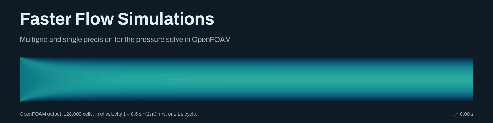
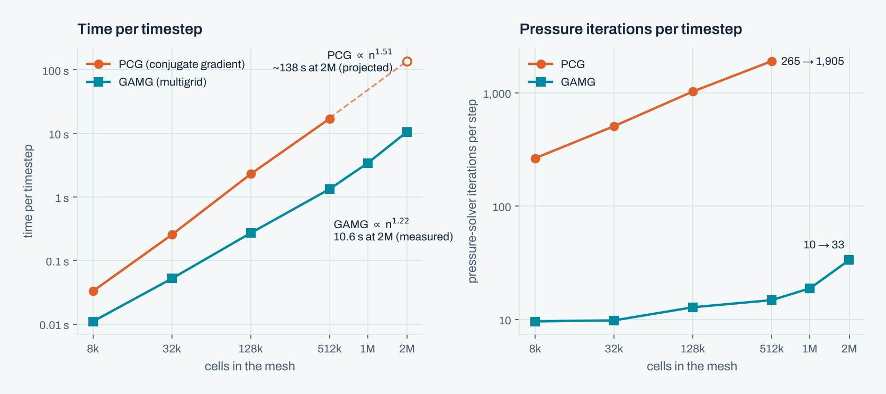
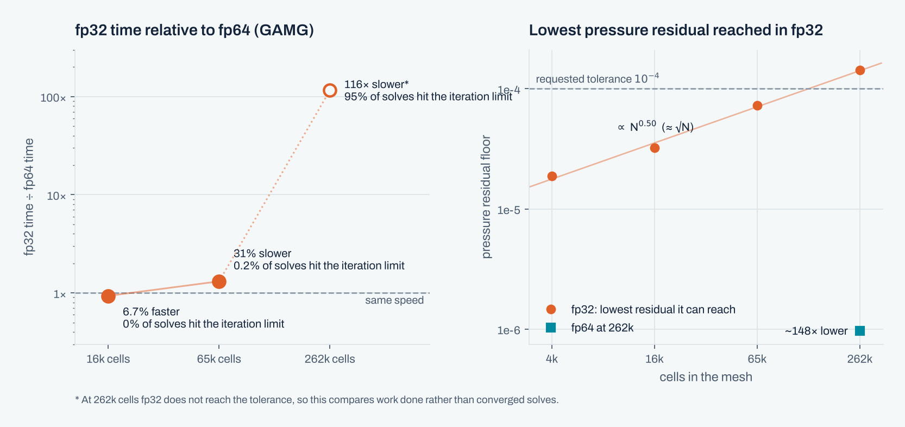
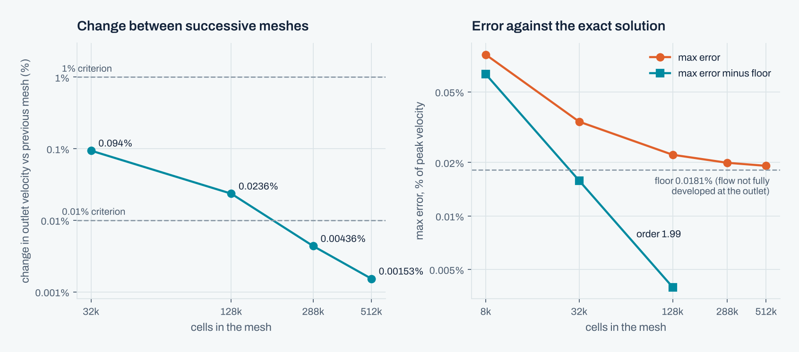
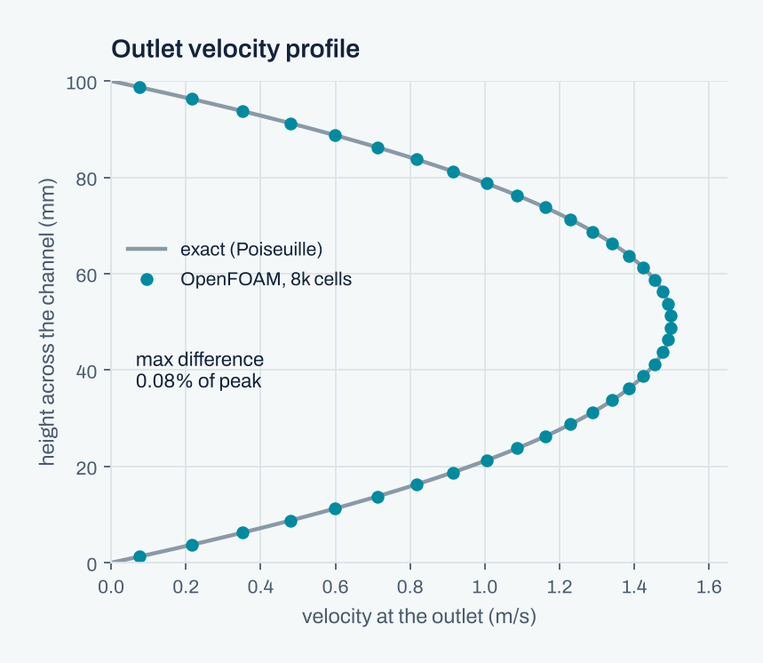
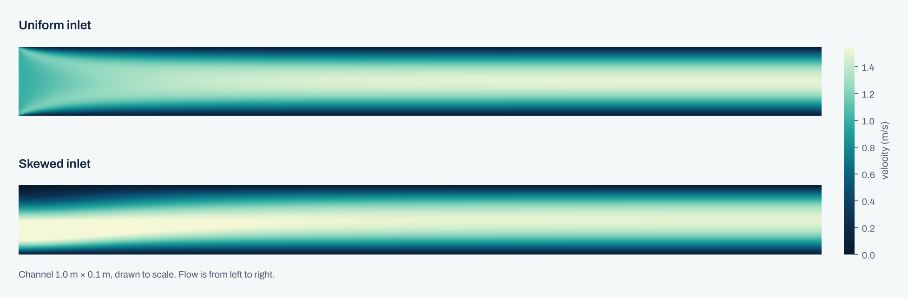

<div align="center">



<br><br>


**[Report (PDF)](docs/report/Faster_Flow_Simulations_report.pdf)** &nbsp;·&nbsp;
**[Slides (PDF)](docs/slides/Faster_Flow_Simulations_slides.pdf)**

</div>

<br>

This is a summer research project from the University of Manchester (2026), done with
collaborators at Arm and the University of Bath.

In an incompressible CFD solver, most of the run time is spent solving a linear system
for the pressure at every timestep. The project looks at two ways of reducing that cost
in OpenFOAM:

1. using an algebraic multigrid solver (GAMG) instead of preconditioned conjugate
   gradient (PCG), and
2. running in single precision (fp32) instead of double precision (fp64).

All tests use a 2D laminar channel flow (Re<sub>H</sub> = 100), which has an exact
solution to compare against.

## Summary of results

| Study | Result |
|---|---|
| Solver scaling | Time per step grows as n<sup>1.22</sup> with GAMG and n<sup>1.51</sup> with PCG. At 2 million cells GAMG takes 10.6 s per step; extrapolating PCG gives about 138 s (13× slower). |
| Precision: accuracy | Where fp32 converges, its answer agrees with fp64 to within 3 × 10<sup>−7</sup> m/s. |
| Precision: memory | fp32 uses 14–28% less memory. |
| Precision: speed | fp32 is 6.7% faster at 16k cells, 31% slower at 65k cells and 116× slower at 262k cells. |
| Mesh independence | Results stop changing by more than 0.01% at about 128k cells. Convergence is second order. |

The numbers in this README can be recomputed from the data in the repository with
[`tools/verify_results.py`](tools/verify_results.py) (see [Running the code](#running-the-code)).

---

## 1. GAMG vs PCG

<picture>
  <source media="(prefers-color-scheme: dark)" srcset="assets/scaling-dark.png">
  
</picture>

The pressure equation is a Poisson equation. With PCG the number of iterations needed
per step goes up as the mesh is refined (265 at 8k cells, 1,905 at 512k cells, roughly
proportional to √n), so the total cost grows faster than the number of cells. GAMG also
works on a sequence of coarser meshes, which removes the large-scale part of the error
cheaply, so its iteration count stays almost constant (10 at 8k cells, 33 at 2 million).

Each run was 10 timesteps on one core, with only the pressure solver changed between
runs. Data: [`results/02_scaling_study/results.csv`](results/02_scaling_study/results.csv).

## 2. Single vs double precision

<picture>
  <source media="(prefers-color-scheme: dark)" srcset="assets/precision-dark.png">
  
</picture>

Precision in OpenFOAM is chosen when it is compiled, so this needed a separate
single-precision build from source ([`build_sp.sh`](scripts/04_fp32_precision/build_sp.sh),
macOS). The fp64 runs use a build from the same source, compiler and flags, so the only
difference between the two is precision.

| Mesh (cells) | fp32 solves hitting the iteration limit | fp32 vs fp64 time | Memory saved | Repeats |
|---|---:|---:|---:|---|
| 16,384 | 0% | 6.7% faster | 13.6% | 3 each |
| 65,536 | 0.2% | 31% slower | 28.3% | 3 each |
| 262,144 | 95% | 116× slower\* | – | fp64 2, fp32 1 |
| 65,536 (PCG) | 0% | 7.7% slower | 27.0% | 3 each |

\* At 262k cells fp32 never reaches the tolerance, so this row compares the work done,
not two converged solves.

In fp32 the pressure residual can only be reduced to a certain level, and this level
increases with mesh size (approximately as √N, from 1.9 × 10<sup>−5</sup> at 4k cells to
1.4 × 10<sup>−4</sup> at 262k). Once it is above the requested tolerance of
10<sup>−4</sup>, GAMG runs to its limit of 1,000 iterations on almost every solve. The
speed difference therefore depends on the fraction of solves that hit the limit rather
than on the mesh size directly. This is consistent with a measurement on Arm hardware by
a collaborator, where fp32 was 21.4% faster and used 33.6% less memory.

A natural next step is mixed precision (OpenFOAM's `SPDP` option), where the linear
solver stays in double precision.

## 3. Mesh independence

<picture>
  <source media="(prefers-color-scheme: dark)" srcset="assets/mesh-dark.png">
  
</picture>

Every mesh in the series passes the usual 1% criterion, including the coarsest (8k
cells), so a tighter 0.01% criterion was used. All outputs meet it by about 128k cells.
The error against the exact solution levels off at 0.0181% of the peak velocity. This is
because the outlet is only about two entrance lengths from the inlet, so the flow is not
quite fully developed there. After subtracting this value the error falls with order
1.99.

Each mesh was run until the velocity field stopped changing (max |ΔU| < 10<sup>−6</sup>
between writes), with the Courant number kept the same.

## Validation and inlet profiles

<table>
<tr>
<td width="38%">
<picture>
  <source media="(prefers-color-scheme: dark)" srcset="assets/validation-dark.png">
  
</picture>
</td>
<td>

The baseline case was compared with the exact Poiseuille profile (peak 1.5 m/s) before
any solver or precision changes. The largest difference at the outlet is 0.08% of the
peak velocity on the 8k mesh.

Two other inlet conditions were run on the 128k mesh. With an oscillating inlet,
U = 1 + 0.5 sin(2πt) m/s (Womersley number ≈ 4), the flow never reverses: the lowest
velocity anywhere in the channel over a cycle is 0.004 m/s. With a skewed inlet that
peaks at one third of the channel height, the profile becomes symmetric along the
channel: the velocity centroid moves from 0.40 to 0.50 of the height, the outlet peak is
1.5002 m/s, and it is within 0.5% of the centre by x ≈ 0.44 m.

</td>
</tr>
</table>

<picture>
  <source media="(prefers-color-scheme: dark)" srcset="assets/fields-dark.png">
  
</picture>

## Note on single-precision runs

A collaborator at Arm found a bug in OpenFOAM's single-precision support. Round-off in
the face areas of the `empty` patches can exceed a `1e-6` threshold in `polyMesh.C`,
which causes x and y to be treated as empty directions. `fvMatrixSolve.C` then skips
the `Ux` and `Uy` equations. The run still completes without an error.

To check an fp32 run:

```bash
grep -c "Solving for Ux" log.icoFoam   # should equal the number of timesteps
grep -c "Solving for Uy" log.icoFoam
```

Using power-of-two cell counts (e.g. 1024 instead of 1000) avoids the problem. All 35
runs in this study pass the check, and
[`run_case.py`](scripts/04_fp32_precision/run_case.py) checks it automatically.

## Running the code

Checking the results and rebuilding the figures does not need OpenFOAM:

```bash
git clone https://github.com/shubh-chawda/faster-flow-simulations.git
cd faster-flow-simulations
pip install numpy matplotlib pillow

python3 tools/verify_results.py    # recompute the numbers in this README
python3 tools/make_figures.py      # rebuild the figures
```

To run the baseline case with OpenFOAM v2512:

```bash
cd cases/channel_baseline_uniform_inlet
blockMesh && checkMesh && icoFoam > log.icoFoam 2>&1
python3 ../../scripts/01_validation/analytical.py . 3     # compare with the exact profile
```

To repeat one of the studies, set up a working folder for it first:

```bash
scripts/make_workdir.sh 04_fp32_precision
cd runs/04_fp32_precision && ./run_all_final.sh
```

More detail is in [`docs/RUNNING.md`](docs/RUNNING.md) and
[`scripts/INDEX.md`](scripts/INDEX.md).

## Repository layout

```
cases/            OpenFOAM cases (meshes are generated with blockMesh)
scripts/          run and analysis scripts for each study (01–05)
results/          CSV files and original figures
data/fields/      solved velocity fields, compressed, used for the figures
scaling_study/    case template for the PCG vs GAMG runs
docs/             report, slides and run guide
tools/            verification and figure scripts
```

## Limitations

- Only one geometry was tested: a straight 2D laminar channel on a uniform mesh, run on
  one core. More complex geometries, turbulence and 3D flows are likely to behave
  differently.
- The precision tests were run on one machine (Apple Silicon). The Arm results show that
  the speed difference depends on the hardware.
- The mesh size at which fp32 stops being faster is somewhere between 16k and 65k cells
  and was not found exactly.
- The precision comparison uses a pressure tolerance of 10<sup>−4</sup>, because fp32
  cannot reach the 10<sup>−6</sup> used in the other studies.

## Future work

- Mixed precision (`SPDP`), with the pressure solve in double precision.
- Repeating the precision tests on Isambard, the Arm-based target system.
- A finer mesh sweep to find where fp32 stops being faster, and testing whether GAMG's
  coarsening settings change the fp32 residual limit.
- Testing more complex geometries.

## Acknowledgements

I would like to thank my supervisor at the University of Manchester, and the
collaborators at Arm and the University of Bath, for their guidance and input. The
single-precision bug described above was found by a collaborator at Arm.

## Citation

See [`CITATION.cff`](CITATION.cff).

## Licence

The code is released under the [MIT licence](LICENSE). The report, slides and figures
are © 2026 Shubh Chawda and shared under
[CC BY 4.0](https://creativecommons.org/licenses/by/4.0/). The Archivo font in
`tools/fonts` is under the [SIL Open Font Licence](tools/fonts/OFL.txt).
